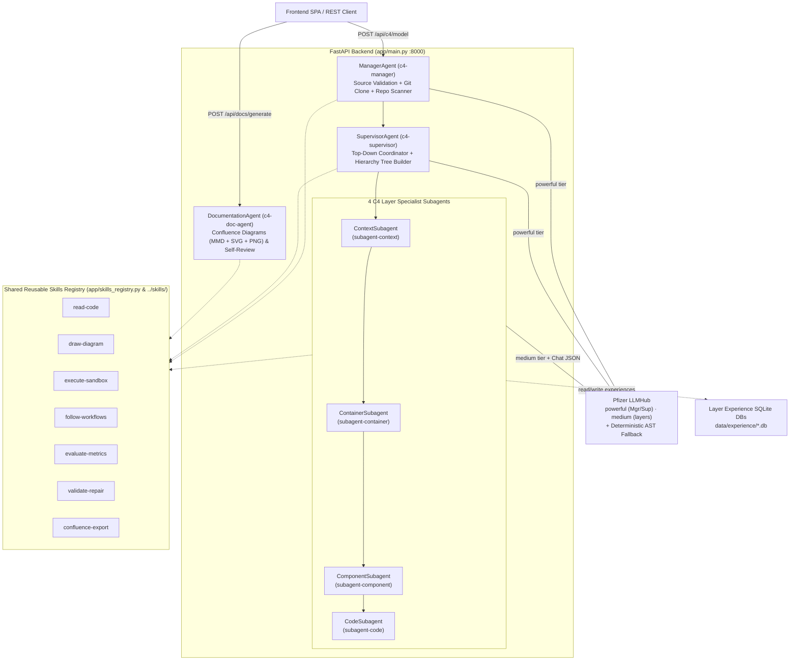
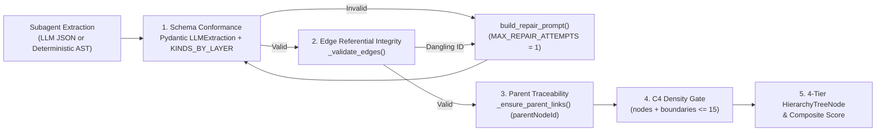

# Orthos — Multi-Agent Backend (`c4-model-visualizer/backend`)

A FastAPI multi-agent service that generates [C4 software architecture models](https://c4model.com), 4-tier Hierarchy Trees, sandbox verifications, and Confluence-ready engineering documentation from any local repository path or remote GitHub URL.

---

## Multi-Agent & Skills Architecture

The backend orchestrates **7 specialized agents** equipped with **7 reusable skills** (`skills/` & `app/skills_registry.py`):

1. **`ManagerAgent` (`c4-manager`)**:
   - Validates whether the input matches the selected source mode (`local` filesystem path vs. `github` repository URL).
   - Performs shallow `git clone --depth 1` for GitHub repositories or resolves local paths, builds a bounded source inventory (`RepoInventory`), and delegates to the Supervisor.
2. **`SupervisorAgent` (`c4-supervisor`)**:
   - Coordinates the **4 C4 Layer Specialist Subagents** sequentially in top-down order (`Context` $\rightarrow$ `Container` $\rightarrow$ `Component` $\rightarrow$ `Code`).
   - Enforces cross-layer `parentNodeId` traceability so every child node links to its parent layer node and assembles the 4-tier `HierarchyTreeNode` forest.
3. **4 Specialist Layer Subagents**:
   - `ContextSubagent` (`subagent-context`): Extracts `person`, `system`, and `systemExternal` elements.
   - `ContainerSubagent` (`subagent-container`): Extracts deployable `container` and `containerDb` units traced to Context systems.
   - `ComponentSubagent` (`subagent-component`): Extracts internal `component` modules traced to Containers.
   - `CodeSubagent` (`subagent-code`): Extracts `codeClass`, `codeInterface`, and `codeEnum` symbols traced to Components.
4. **`DocumentationAgent` (`c4-doc-agent`)**:
   - Elite software engineering & computer science documentation agent (`app/doc_agent.py`) that reads the codebase, executes the sandbox with dummy data, computes evaluation metrics, generates concise Confluence-adaptable Mermaid (`.mmd`), vector (`.svg`), and raster (`.png`) diagrams, and runs an automated logical self-review pass.

---

## Backend Implementation & Workflow Diagrams (Mermaid)

### 1. Multi-Agent Orchestration & Shared Skills Topology



### 2. Evaluation Metrics & Self-Healing Validation Pipeline



---

## Project Layout

```text
c4-model-visualizer/backend/
├── Dockerfile                  # Python 3.12-slim + git container image
├── .dockerignore
├── .env.example
├── requirements.txt
├── app/
│   ├── main.py                 # FastAPI endpoints (/api/c4/model, /api/agents, /api/skills, /api/sandbox/run, /api/docs/generate)
│   ├── agents.py               # ManagerAgent, SupervisorAgent, and 4 C4 Layer Specialist Subagents
│   ├── doc_agent.py            # DocumentationAgent (c4-doc-agent) for Confluence MMD/SVG/PNG generation & self-review
│   ├── skills_registry.py      # 7 reusable agent skills + sandbox dummy-data runner + evaluation metrics engine
│   ├── c4_service.py           # Single-layer LLM extraction, edge validation & retry loop
│   ├── schemas.py              # Pydantic data contracts (LayerResponse, HierarchyModelResponse, C4Node, C4Edge)
│   ├── repo_scanner.py         # Bounded source-tree context builder
│   ├── prompts.py              # Per-layer C4 system/user/repair prompts
│   ├── llmhub_adapter.py       # Per-agent Pfizer LLMHub adapters (powerful/medium)
│   ├── experience_store.py     # SQLite code-reading experience DBs for layer agents
│   ├── llm_client.py           # Compatibility facade over LLMHub adapters
│   └── config.py               # Loads config/llmhub.yaml + env overrides
├── config/
│   └── llmhub.yaml             # LLMHub credentials, model tiers, per-agent bindings
└── scripts/
    ├── run_doc_agent.py        # CLI runner for c4-doc-agent -> generates ../documentation/
    ├── check_llmhub.py         # Verifies LLMHub connectivity & model tiers
    └── generate_file.py        # Single-file instruction generator
```

---

## API Endpoints

| Method | Path | Description |
| :---: | :--- | :--- |
| `GET` | `/health` | Checks Pfizer LLMHub reachability and lists available models |
| `GET` | `/api/agents` | Lists `c4-manager`, `c4-supervisor`, the 4 layer subagents, `c4-doc-agent`, and their equipped skills |
| `GET` | `/api/skills` | Returns the catalog of 7 reusable skills (`read-code`, `draw-diagram`, `execute-sandbox`, `follow-workflows`, `evaluate-metrics`, `validate-repair`, `confluence-export`) |
| `POST` | `/api/c4/model` | Runs the full multi-agent pipeline on a local path or GitHub URL and returns all 4 layers + 4-tier `hierarchy` tree |
| `POST` | `/api/c4/{layer}` | Generates a single C4 layer (`context`, `container`, `component`, `code`) |
| `POST` | `/api/sandbox/run` | Executes the pipeline in an isolated temporary sandbox with synthetic dummy data |
| `POST` | `/api/docs/generate` | Runs `c4-doc-agent` to generate Mermaid, SVG, PNG, and Confluence documentation |

---

## Pfizer LLMHub Setup

Credentials and model tiers live in [`config/llmhub.yaml`](config/llmhub.yaml) (see [LLMHub endpoints](https://docs.platforms.pfizer/llmhub/docs/llmhub-endpoints)):

| Agent | Tier | Default model |
| :--- | :--- | :--- |
| `c4-manager`, `c4-supervisor`, `c4-doc-agent` | **powerful** | `gpt-4o` |
| `subagent-context` … `subagent-code` | **medium** | `gpt-4.1-mini` |

Layer specialists also write/read lightweight SQLite experience DBs under `data/experience/` to refine code deciphering across runs.

```bash
cd c4-model-visualizer/backend
cp .env.example .env   # set LLMHUB_API_KEY=
pip install -r requirements.txt
python scripts/check_llmhub.py
```

### 1. Start the Backend Server

```bash
cd c4-model-visualizer/backend
./.venv/bin/python -m uvicorn app.main:app --host 127.0.0.1 --port 8000 --reload
```

### 2. Run the Documentation Agent (`c4-doc-agent`)

```bash
cd c4-model-visualizer/backend
./.venv/bin/python scripts/run_doc_agent.py
```

This populates `c4-model-visualizer/documentation/` with all 6 Mermaid `.mmd` files, vector `.svg` files, Confluence `.png` files, and Markdown specifications.
