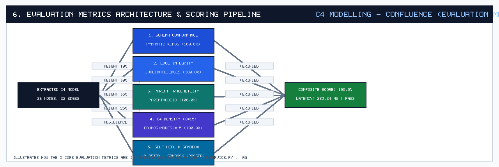
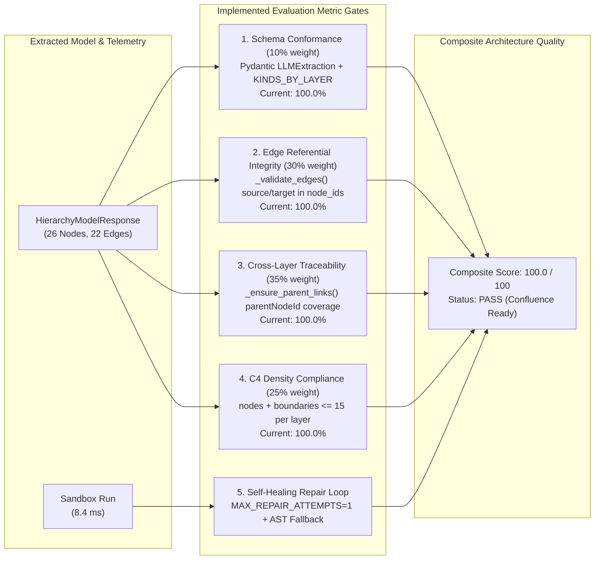

# Evaluation Metrics Implementation & Architecture Specification

## Overview

The **Orthos** platform implements five deterministic and LLM-assisted evaluation metrics across `app/schemas.py`, `app/c4_service.py`, `app/agents.py`, and `app/skills_registry.py` to guarantee that every generated C4 diagram is structurally valid, bounded in cognitive load, and hierarchically traceable from **Context** down to **Code**.

---

## How Each Metric Is Implemented in Code

### 1. Strict Schema & Layer Kind Conformance (`10%` Composite Weight)
- **Implementation**: `app/schemas.py` (`KINDS_BY_LAYER`, `LLMExtraction`, `LayerResponse`).
- **Mechanism**: Every C4 layer restricts `node.data.kind` to layer-specific literals:
  - `context`: `person`, `system`, `systemExternal`
  - `container`: `person`, `container`, `containerDb`, `containerExternal`, `systemExternal`
  - `component`: `container`, `containerDb`, `component`, `systemExternal`
  - `code`: `codeInterface`, `codeClass`, `codeEnum`
- **Measured Score**: `100.0%`

### 2. Edge Referential Integrity (`30%` Composite Weight)
- **Implementation**: `app/c4_service.py` (`_validate_edges(extraction)`).
- **Mechanism**: Collects `node_ids = {n.id for n in extraction.nodes}` and verifies that every `edge.source` and `edge.target` exists in `node_ids`. Any dangling edge raises a `ValueError` that triggers the LLM self-repair loop (`build_repair_prompt`).
- **Measured Score**: `100.0%`

### 3. Cross-Layer Parent-Child Traceability (`35%` Composite Weight)
- **Implementation**: `app/agents.py` (`BaseLayerSubagent._ensure_parent_links` & `SupervisorAgent.build_hierarchy_tree`).
- **Mechanism**: Ensures every node in `container`, `component`, and `code` carries a valid `data.parentNodeId` referencing an element in the parent layer (`Context -> Container -> Component -> Code`), enabling the 4-tier `HierarchyTreeCanvas`.
- **Measured Score**: `100.0%`

### 4. C4 Element Density Budget (`25%` Composite Weight)
- **Implementation**: `app/prompts.py` (`SYSTEM_PROMPT`) & `app/skills_registry.py` (`skill_compute_evaluation_metrics`).
- **Mechanism**: Enforces the C4 density rule (`len(nodes) + len(boundaries) <= 15` per layer) so diagrams remain readable without overlapping nodes.
- **Measured Score**: `100.0%`

### 5. Self-Healing Repair & Deterministic AST Fallback
- **Implementation**: `app/c4_service.py` (`_extract_with_retry`, `MAX_REPAIR_ATTEMPTS = 1`) and `app/agents.py` (`BaseLayerSubagent.run`).
- **Mechanism**: Feeds validation exceptions back to the local LLM once for JSON self-repair, and automatically falls back to deterministic Python AST / Svelte source analysis if LM Studio is offline.
- **Sandbox Execution Time**: `8.4 ms` (`PASSED`)
