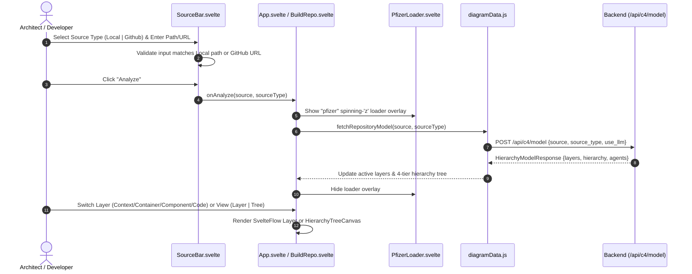

# Orthos — Frontend (`c4-model-visualizer/frontend`)

> *“Design is the silent ambassador of thought; code is merely its echo.”*

The **Orthos** frontend is an interactive Svelte 5 + Vite single-page application powered by [`@xyflow/svelte`](https://svelteflow.dev/) for exploring, designing, and validating hierarchical [C4 software architecture models](https://c4model.com/) across all four C4 layers (**Context**, **Container**, **Component**, and **Code**) plus a cross-layer **Hierarchy Tree** view.

---

## Key Capabilities

1. **Dual Workspace Modes (`Visualizer` & `Developer`)**:
   - **Visualizer Tab**: Inspect any local repository or remote GitHub repository across the 4 C4 layers (`Context`, `Container`, `Component`, `Code`) or switch to the **Tree** view (`HierarchyTreeCanvas.svelte`) to see how Context systems decompose into Containers, Components, and Code classes/interfaces.
   - **Developer Tab (`BuildRepo.svelte`)**: Interactive drag-and-drop C4 architecture studio with a **C4 Shape Library**, **System Boundary** grouping, inline Inspector, **Layer selector** (`Context` / `Container` / `Component` / `Code`), **Layer | Tree** view switcher, and live **Implementation Plan** synthesis.
2. **Three-Section Source Bar (`SourceBar.svelte`)**:
   - **Section 1 (`1 · Source Path`)**: Input field for a local directory path or GitHub repository URL (`https://github.com/owner/repo`) with real-time validation messages underneath.
   - **Section 2 (`2 · Source Type`)**: Dropdown (`Local` | `Github`) that validates path/URL format against the chosen source mode.
   - **Section 3 (`3 · Actions`)**: **Analyze** button (triggers the multi-agent backend pipeline) and **Reset Demo** button.
3. **Animated `pfizer` Word Loader (`PfizerLoader.svelte`)**:
   - Displays the lowercase **`pfizer`** wordmark with the letter **`z`** continuously spinning $360^\circ$ around its vertical axis (`rotateY(0deg -> 360deg)`) while repository analysis or layer transitions are in progress.
4. **4-Tier Hierarchy Tree Canvas (`HierarchyTreeCanvas.svelte`)**:
   - Visualizes parent-child traceability (`parentNodeId`) from **Level 1 · Context** $\rightarrow$ **Level 2 · Container** $\rightarrow$ **Level 3 · Component** $\rightarrow$ **Level 4 · Code**.
   - Automatically disables the C4 Layer dropdown when **Tree** view is active (`disabled={viewMode === 'tree'}`).

---

## Frontend Architecture & Implementation Flow (Mermaid)

### 1. Component & State Flow

```mermaid
flowchart TB
    subgraph UI["Orthos Frontend (Svelte 5 + Vite)"]
        Header["AppHeader.svelte<br/>Brand + Mode Switcher (Visualizer | Developer)"]
        SourceBar["SourceBar.svelte<br/>1. Source Path | 2. Source Type (Local/Github) | 3. Actions"]
        Loader["PfizerLoader.svelte<br/>Animated 'pfizer' Wordmark (Spinning 'z')"]

        subgraph VisualizerMode["Visualizer Tab (App.svelte)"]
            VisTopBar["Canvas Top Bar<br/>View Toggle (Layer | Tree) + LayerSelect"]
            FlowCanvas["SvelteFlow Canvas<br/>C4Node + BoundaryNode + C4Edge"]
            TreeCanvas["HierarchyTreeCanvas.svelte<br/>4-Tier SVG/Card Tree (Context -> Container -> Component -> Code)"]
            DetailPanel["DetailPanel + LegendBar + LayerInfoCard"]
        end

        subgraph DeveloperMode["Developer Tab (BuildRepo.svelte)"]
            Palette["Shape Library Palette<br/>C4 Elements + Boundary Tool"]
            DevTopBar["Canvas Toolbar<br/>View Toggle (Layer | Tree) + LayerSelect + Plan Button"]
            BuildCanvas["BuildCanvas.svelte<br/>Interactive Drag/Connect/Resize Canvas"]
            Inspector["Right Dock<br/>Element Inspector & Implementation Plan"]
        end
    end

    DataStore["diagramData.js<br/>Static Demo JSON + Live Backend Model Store"]
    BackendAPI["FastAPI Multi-Agent Backend<br/>POST /api/c4/model"]

    Header --> VisualizerMode
    Header --> DeveloperMode
    SourceBar -->|Analyze (source, sourceType)| BackendAPI
    BackendAPI -->|HierarchyModelResponse| DataStore
    DataStore --> FlowCanvas
    DataStore --> TreeCanvas
    DataStore --> BuildCanvas
    VisTopBar --> FlowCanvas
    VisTopBar --> TreeCanvas
    DevTopBar --> BuildCanvas
```

### 2. User Interaction & Multi-Agent Request Sequence



---

## Project Structure

```text
c4-model-visualizer/frontend/
├── Dockerfile                  # Multi-stage Node 22 build -> Nginx 1.27 Alpine runtime
├── nginx.conf                  # SPA routing + /api/ reverse proxy to backend:8000
├── package.json                # Svelte 5, Vite 6, @xyflow/svelte
├── vite.config.js              # Dev server (:5173) with /api proxy to 127.0.0.1:8000
└── src/
    ├── App.svelte              # Root shell, Visualizer canvas, SourceBar & loader orchestration
    ├── app.css                 # Global styling and C4 theme tokens
    └── lib/
        ├── diagramData.js      # Reactive C4 layer store, hierarchy tree builder & API client
        ├── buildCatalog.js     # Developer palette catalog & C4 connection validation rules
        ├── data/               # Default static C4 JSON layers (context, container, component, code)
        └── components/
            ├── AppHeader.svelte            # Orthos header, catalog/studio nav & tab bar
            ├── SourceBar.svelte            # 3-section source bar (Path, Local/Github Type, Actions)
            ├── LayerSelect.svelte          # C4 layer dropdown (disabled in Tree view)
            ├── HierarchyTreeCanvas.svelte  # 4-tier Context -> Container -> Component -> Code tree
            ├── PfizerLoader.svelte         # Lowercase "pfizer" loader with 3D spinning "z"
            ├── DetailPanel.svelte          # Selected node/edge inspection drawer
            ├── LayerInfoCard.svelte        # C4 layer guidance & agent summary badge
            ├── LegendBar.svelte            # C4 element color/kind legend
            ├── nodes/
            │   ├── C4Node.svelte           # Custom C4 node renderer
            │   └── BoundaryNode.svelte     # Dashed C4 boundary container node
            ├── edges/
            │   └── C4Edge.svelte           # Custom labeled technology edge
            └── build/
                ├── BuildRepo.svelte        # Developer mode workspace & implementation plan generator
                ├── BuildCanvas.svelte      # Interactive drag/drop & resize SvelteFlow canvas
                ├── ShapeIcon.svelte        # SVG icons for C4 element kinds
                └── ToastBanner.svelte      # Connection rule feedback banner
```

---

## Running Locally

### Development Server (Vite)

```bash
cd c4-model-visualizer/frontend
npm install
npm run dev
```

Open `http://127.0.0.1:5173/`. Requests to `/api/*` are automatically proxied to the FastAPI backend at `http://127.0.0.1:8000`.

### Production Container (Docker Compose)

From `c4-model-visualizer/`:

```bash
docker compose up --build
```

The frontend is served by Nginx at `http://localhost:8080` and proxies `/api/*` requests to the `backend` service on port `8000`.
